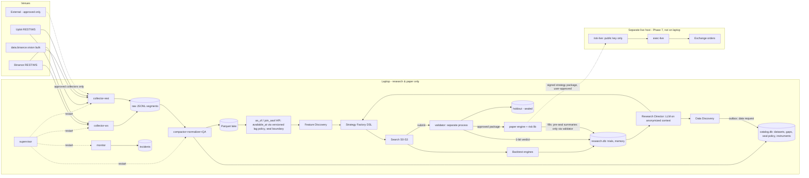

# 자율형 AI 퀀트 연구·자동매매 시스템 개발 계획 v2.1 (Binance Spot·USDⓈ-M Futures + Upbit KRW Spot)

> **v2.1 (2026-11-08) — 최소 수정.** 2026-11-08 기술 검토(서브에이전트 4개 + 메인 세션 재계산)에서 **실제 결함으로 확인된 항목만** 반영했습니다. 아키텍처와 목표는 v2와 같습니다. 변경 위치는 §18.2에 정리했습니다. 이 문서는 **설계 기준서**이고, 실행 단계는 `docs/plans/2026-11-08-phase0-1-build.md`가 관리합니다.

> **상태: 계획만 작성한 상태이며 아직 승인 전입니다.** 이 문서 외에는 코드, 설정, 패키지, DB, API 키, 주문을 만들거나 바꾸지 않았습니다.
>
> **v2 변경 사항 (2026-11-08)**
> - Upbit 조사 결과를 반영했습니다.
> - 서브에이전트 4개의 독립 재검토 결과를 반영했습니다: 퀀트 방법론, 아키텍처·데이터·실현 가능성, 보안, Upbit·규제 조사.
> - 반영 내역은 §18 재검토 반영표에 있습니다.
>
> **근거와 표기**
> - Binance 정보: 공식 문서와 data.binance.vision S3 목록
> - Upbit 정보: docs.upbit.com/kr. 한국 계정 기준이며 global-docs는 다른 법인용이라 값이 다릅니다.
> - 규제 정보: 금융위원회(FSC)·금융정보분석원(FIU) 보도자료, 법령정보센터(law.go.kr). 법률 판단이 아니라 사실 정리이며, 결론은 모두 **법률 확인 필요**로 둡니다.
> - 이 PC의 상태는 읽기 전용 명령으로 직접 측정했습니다.
> - 확인하지 못한 내용은 **미확인**, 측정하지 않고 계산한 값은 **추정**이라고 표기했습니다.
>
> **사용자 결정 (2026-11-08)**
> 1. 실행 장소는 이 PC 하나입니다.
> 2. 연구는 분~일 단위 시간축부터 시작합니다.
> 3. 프로젝트는 `C:\dev\quant-research`에 새로 만들고, 기존 `C:\Project`는 수정하지 않고 참고만 합니다.
> 4. 대상 거래소에 Upbit를 추가합니다.

---

## 1. Executive Summary

**목표.** AI(Research Director)가 다음 과정을 근거에 따라 반복하는 **연구 시스템**을 만듭니다. 실거래 권한은 이 시스템과 분리합니다.
- 가설을 세우고, 필요한 데이터를 판단해 확보합니다.
- 전략을 생성하고 탐색합니다.
- 독립 검증을 거칩니다.
- 결과를 학습해 다음 연구를 다시 계획합니다.

수익은 보장하지 않습니다. 이 시스템의 산출물은 "검증을 통과한 가설"이며, **채택된 전략이 0개인 결과도 정상**으로 봅니다.

**v1과 달라진 핵심 결정**
1. **수집을 가장 먼저 시작합니다.** 지금 받지 않으면 영원히 받을 수 없는 데이터가 있습니다.
   - Binance: OI·롱숏 비율 30일, 청산(WS로만 제공), bookTicker 벌크 중단
   - Upbit: 체결 7일, 초봉 3개월, 호가는 이력 없음, 공식 벌크 다운로드 없음

   그래서 스키마보다 먼저 **원본 캡처기(raw capture, JSONL)**를 띄웁니다. 정규화 코드는 그 뒤에 원본을 다시 읽어(재생) 만듭니다.
2. **홀드아웃 봉인을 첫날부터 적용합니다.** `as_of` 데이터 접근 계층이 데이터셋별 봉인 경계(`research_max_time`)를 처음부터 강제합니다. 시도 회계(평가한 후보와 횟수 기록)도 Phase 2부터 기록합니다.
3. **LLM 사전지식 누수를 막습니다.** LLM은 학습 시점까지의 시장 사건을 이미 압니다. 그래서 LLM에 넣는 데이터는 심볼과 날짜를 익명화하고, 최종 판정은 **모델 학습 기준일 이후 구간**에서만 합니다.
4. **다중검정 보정을 바로잡습니다.**
   - 실효 시도 수를 군집화로 추정하고, DSR에 V[SR]을 넣습니다.
   - S2 이상 시도의 일간 손익 벡터를 저장하고, 선별 구간과 확인 구간을 시간으로 분리합니다.
   - 홀드아웃은 전역 예산과 1비트 반환, 승격 직전 1회성 최종 검정으로 운영합니다.
5. **실거래는 노트북 밖에서 합니다.**
   - 같은 관리자 계정 안에서 프로세스만 나누는 방식으로는 키를 보호할 수 없습니다.
   - 대칭 HMAC 승인으로는 "AI는 정책을 바꿀 수 없다"를 강제할 수 없습니다.
   - 따라서 실거래는 **별도 호스트(권장: 고정 IP VPS)와 비대칭 서명(개인키는 오프호스트)**을 전제로 합니다.
6. **규제상 현실을 반영합니다.**
   - Binance는 FIU 신고 사업자 28곳 명단에 없습니다(2026-06-24 FSC 보도자료).
   - Upbit는 신고 사업자입니다.
   - 따라서 **연구와 모의매매는 두 거래소 모두 대상**으로 하고, **실거래 거래소는 법률 확인 후 사용자가 결정**합니다. 국경 간 차익거래와 Binance 실거래는 확인 전까지 연구·모의 단계로만 한정합니다.

**결론 요약.** Phase 0~1은 승인하면 바로 시작할 수 있습니다(필요한 승인 항목은 §17). Phase 7(실거래)은 법률 확인, 실거래 호스트와 고정 IP, 서명 체계가 갖춰지기 전까지 진행할 수 없습니다.

---

## 2. 현재 개발환경 분석 결과

| 항목 | 실측값 | 의미 |
|---|---|---|
| OS | Windows 11 Home 26200 | Hyper-V 없음. WSL2와 VMware 25는 있음 |
| CPU | i5-1340P, 12코어(P 4 + E 8) / 16스레드 | 노트북이라 장시간 고부하 시 열로 클럭이 내려감. 라이브러리 스레드 수 상한 필수 |
| RAM | 15.6GB, 측정 시 여유 4.5~5.1GB(Claude 2개 약 1GB, 다른 앱 약 1.1GB 사용 중) | **가장 큰 병목.** 작업자는 1~2개로 시작 |
| 저장공간 | C: 324GB 여유, KLEVV C710 NVMe | 유휴 시 80°C, 절전 BSOD 이력, 오프사이트 백업 없음. **SMART 온도는 일반 권한으로 읽을 수 없음**(접근 거부 확인) |
| GPU | Intel Iris Xe, CUDA 없음 | GPU 학습 불가. CPU용 GBDT와 선형 모델까지 |
| 전원 | 절전 꺼짐(AC/DC 0), 배터리 있음 | 상시 가동 가능. 재부팅 후 자동 재개 필요 |
| 시계 | Binance 서버 대비 **-17ms**(RTT 271ms) 실측. 검토 에이전트의 `w32tm` 조회에서는 원본이 Free-running System Clock(동기화 안 됨) | 현재 오차는 작지만 동기화 상태가 아님. 재부팅 후 드리프트 위험 → 거래소 서버 시각으로 상시 보정(§5.4) |
| Python·도구 | uv 0.13.7, CPython 3.12~3.14, git, gh, Claude Code 2.1.319, 검증 하네스(게이트·CI·hook) | `/new-project` Python 스택과 게이트를 그대로 사용 |
| 컨테이너 | Docker 29.6(엔진 꺼짐), VMware 25 | v1에서는 Docker를 쓰지 않음 |
| 네트워크 | Binance REST(api, fapi) 200, data.binance.vision 200 | 선물 WS(`fstream`)는 2026-08 기존 보고서에 "차단"으로 기록, **현재 미확인**. Upbit 접속도 Phase 0에서 확인 |
| 기존 프로젝트 | `C:\Project`: 수집기 약 5,000줄(Upbit WS, 캔들 백필, 김치프리미엄, FX 포함), 테스트·CI·lockfile 없음, Postgres 5432를 모든 인터페이스에 노출(compose:22) | 참고만 함. 아래 참고 |

**`C:\Project`에서 참고할 것**
- 심볼 동기화의 감소 가드(`sync_symbols.py:44-53`)와 상장폐지 연속 확인
- 백필 체크포인트
- WS 재연결 백오프
- `data_quality_log` 상태 분류
- Upbit 캔들 백필 간격(`upbit_candles_backfill.py`)
- FX stale 감지(`kimchi_premium/fx.py`)
- `ntp_resync.ps1`

**`C:\Project`에서 반복하지 않을 것**
- `time` 컬럼의 의미가 테이블마다 다름
- 펀딩과 OI에 `now()` 기록
- FRED의 미래 정보 누수
- 만료 없는 호가 캐시
- 선물 1분봉 누락(추정)
- 끝부분만 확인하는 공백 검사
- 버전 미고정

**하드웨어로 가능한 연구 규모.** 아래는 **Phase 0~2에서 실측할 목표(가설)**이며 확인된 용량이 아닙니다.
- 벡터화 백테스트: 심볼 단위로 나눠 처리할 때 하루 10⁵ 단위 평가
- 정밀 백테스트: 하루 10³ 단위 평가
- 1분봉 50심볼×5년은 약 1.3억 행입니다. 열 하나가 약 1GB이므로 반드시 심볼·기간 단위 청크로 처리합니다.

**GPU나 분산 실행이 필요해지는 시점.** 아래 경우 사용자 승인을 받아 클라우드를 다시 판단합니다.
- 틱·호가 딥러닝을 할 때
- 체결 단위 정밀 백테스트를 대량으로 할 때
- 정밀 평가 대기열이 7일 분량을 넘을 때

---

## 3. 최종 시스템 아키텍처

### 3.1 구성 원칙 (v2)
**저장소와 데이터 위치**
- 코드: `C:\dev\quant-research`(git)
- 데이터: **저장소 밖** `C:\dev\qr-data\`

**데이터 영역**
| 영역 | 내용 |
|---|---|
| `raw/` | 실시간 수집한 원본 JSONL 세그먼트. 1시간마다 새 파일, 줄 단위 flush, 수신 시각과 시계 offset 포함. **WAL, 원본 보관소, 테스트 fixture 원천을 겸함.** v2.1 추가: **fsync는 1~5초 또는 N줄마다, 세그먼트를 닫을 때도 실행**합니다. 리더는 마지막 개행 이후의 잘린 꼬리를 격리합니다. 시작할 때 마지막으로 내구성이 확인된 시각부터 현재까지를 gap으로 자동 등록합니다. 각 줄 또는 세그먼트 헤더에 collector 버전과 git SHA를 기록합니다. **T0 원본은 압축해 영구 보관합니다**(다시 받을 수 없기 때문) |
| `lake/` | 정규화 Parquet. 닫힌 세그먼트와 벌크 파일을 컴팩션해서 만듦. v2.1 수정: **파일은 불변으로 두고 새 이름으로 쓴 뒤(fsync) `catalog.db` 트랜잭션에서 포인터만 바꿉니다.** Windows에서는 리더, Defender, 인덱서가 대상 파일을 열고 있으면 `os.replace`가 PermissionError로 실패하므로 교체 방식을 쓰지 않습니다. 이전 버전 파일은 바이템포럴 이력으로 남깁니다 |
| `manifest/` | 벌크 원본의 URL, sha256, LastModified, 버전. **벌크 zip은 검증 후 삭제**하고 이 기록만 남김(다시 받을 수 있으므로) |
| `meta/` | SQLite. **소유 프로세스마다 파일 1개, 쓰는 쪽도 1개**: `collector.db`, `catalog.db`, `research.db`, `validator.db`, `ledger.db`. 다른 프로세스는 `mode=ro`로만 읽음 |
| `holdout/` | 봉인 구간. validator 소유. Phase 5에서 ACL 적용 검토 |

**DuckDB 사용 방식.** 영속 `.duckdb` 파일은 만들지 않습니다(파일을 쓰기로 연 프로세스가 있으면 다른 프로세스가 열 수 없기 때문). 각 프로세스가 in-memory로 Parquet을 직접 조회합니다.

**프로세스 (v1 범위)**
- `supervisor`: 자식 프로세스를 감시하고, 비정상 종료 시 백오프와 함께 재시작합니다. v2.1: 프로세스마다 **단일 인스턴스 잠금**(잠금 파일 또는 named mutex)을 두어, 작업 스케줄러 실행과 수동 실행이 겹쳐도 같은 세그먼트에 두 프로세스가 쓰지 않게 합니다.
- `collector-ws`, `collector-rest`: 장애 범위를 줄이려고 둘로 나눕니다.
- `compactor`
- `monitor`
- `research`, `validator`, `paper`는 해당 Phase에서 추가합니다.
- `risk`는 Phase 6까지 라이브러리 호출로 둡니다.
- **실거래(`exec-live` + `risk-live`)는 노트북에 두지 않습니다**(§11).

**프로세스 간 통신.** 요청하는 쪽 DB의 `outbox` 테이블과 처리하는 쪽 DB의 `ack` 테이블을 폴링합니다. 소켓이나 메시지 큐는 쓰지 않습니다.

**자원 상한**
- `POLARS_MAX_THREADS`, `NUMBA_NUM_THREADS`, DuckDB `threads`와 `memory_limit`를 설정 파일로 강제합니다.
- 여유 RAM이 1.5GB 아래로 내려가면 작업자를 일시정지합니다.
- collector의 목표 메모리는 300MB 이하입니다.

**네트워크 노출.** 대기(listen)하는 포트가 없습니다. 상태 화면을 만들게 되면 `127.0.0.1`에만 바인딩합니다.

### 3.2 데이터·제어 흐름


**제어 흐름 원칙**
- 연구 루프는 상태 기계(§10)로 움직입니다.
- 수집, 컴팩션, 검증, 모의매매는 연구 루프와 독립적으로 상시 동작합니다.
- 연구 쪽은 수집기 설정을 바꿀 수 없고, 데이터 요청을 outbox에 넣는 것만 할 수 있습니다.

---

## 4. 모듈별 상세 기술 명세

**공통 사항**
- 스택: Python 3.12 또는 3.13, uv(+`uv.lock` 커밋), pydantic v2, structlog(JSON, 비밀값 마스킹), pytest + hypothesis, pyright strict, ruff
- 의존성 감사: `pip-audit`(CI)
- GitHub Actions: SHA로 고정
- CI에서 실네트워크 호출 금지: 미국 러너에서 451이 날 수 있음(미확인). 실네트워크 스모크 테스트는 `validate:`로만 실행
- 장애 처리 원칙:
  - 예외를 숨기지 않습니다.
  - 외부 호출에는 명시적 타임아웃을 둡니다.
  - 재시도는 횟수 상한, 백오프, 지터를 두고 멱등 연산에만 합니다.

| 모듈 | 책임 | 입력 → 출력 | 핵심 스키마 | 장애 처리 | 테스트 | 완료 기준 |
|---|---|---|---|---|---|---|
| **A. Research Director** | 목표, 가설, 우선순위, 해석, 재계획 | 익명화한 메모리 요약 + 카탈로그 + 예산 → `Hypothesis`/`ExperimentPlan`/`DataRequest` | `hypothesis(id, family, statement, falsification_test, required_data, prior, anonymized=1)` | 스키마 위반 시 1회 재요청 후 폐기·기록. 예산 초과 시 PAUSED | 가짜 LLM으로 상태 전이·예산 테스트 | 무인 10사이클, 중복 실험 0, 모든 전이에 근거 기록 |
| **B. Data Discovery** | 데이터 부족 판단, 소스 탐색, VOI | 실패 분석 → `DataSourceProposal` | `data_source(id, provider, url, license, history_from, cost, status)` | 외부 텍스트는 **도구 없는 요약기**를 거친 필드만 사용, 원문은 untrusted 표시. URL과 패키지는 허용 목록과 대조 | VOI 합성 테스트 | 승인된 제안만 수집기로 구현 |
| **C. Data Collection** | 벌크, REST, WS, 원본 캡처, 컴팩션, 시점 필드, QA, 카탈로그 | 거래소 → raw → lake + catalog | §5 | 재연결, 깊이 재동기화, gap 등록, 체크섬 불일치 시 재다운로드, 429/418 처리 | 녹화한 응답으로 재생, 누수 테스트, property 테스트 | 7일 운영(§13 validate) |
| **D. Feature Discovery** | 특징 생성·평가 | lake → 시점 정합 특징 + 평가표 | `feature(id, expr_ast, lookback, lag_policy)`, `feature_eval(..., ic, ic_hac_t, ...)` | 특징 단위로 무효 처리 | 미래 값 주입 시 탐지되는지 확인 | 특징 30종 이상 누수 테스트 통과 |
| **E. Strategy Factory** | DSL, 생성, 정규화, 구조 검증 | 가설·특징 → `StrategySpec` | §7 | 무효 AST 거부 + 사유 기록. **깊이, 노드 수, window, 상수 범위 상한** | 문법 property, 정규화 동치 | 11개 계열 템플릿 |
| **F. Search** | S0~S3, 예산 배분, 시도 회계 | Spec → 생존 후보 + `trial` | `trial(id, spec_hash, stage, fold, metrics, pnl_daily_ref, cost_s)` | 재큐잉 멱등. **적합도 평가 1회 = trial 1건(불변식)** | 시도 회계 불변식 테스트 | 회계 누락 0 |
| **G. Backtest** | 벡터화(선별) + 이벤트(기준) | Spec + 데이터 → 거래 내역·손익 | `backtest_run(...)` | 결측 구간 정책(§9) | 손으로 계산한 사례, 두 엔진 교차 | 기준 사례 100% 일치 |
| **H. Validation** | 누수, 과최적화, 선택 편향, 국면 | 제출 → 1비트 판정(+내부 보고서) | `validation(...)`, `holdout_access_log`(해시 체인) | 판정 불가 시 Unknown | **신호 없는 합성 시장에서 파이프라인 전체를 돌려 종단 FWER 측정, 알파를 심은 데이터로 검정력 측정** | FWER ≤ 사전 등록값 |
| **I. Research Memory** | 가설, 실험, 실패, 발견 | 결과 → 검색 | `finding(evidence_refs NOT NULL, superseded_by)`, `failure(cause_code)` | 쓰기 실패 시 루프 정지 | 마이그레이션(번호 SQL + `user_version`) | 재시작 후 복원 |
| **J. Portfolio & Risk (모의)** | 결합, 배분, 한도 | 신호 → 목표 포지션 | `policy(version, limits, expires, sig)` | 서명 검증 실패 시 모든 주문 거부 | 한도 경계값 테스트 | 위반 주문 0 |
| **K. Execution** | 모의(노트북), 실거래(별도 호스트) | 목표 → 주문, 체결, 원장 | `order(client_id UNIQUE, state∈{PENDING_SUBMIT, ACKED, …})` | 상태가 불확실하면 조회만 하고 재전송 금지. 대사 불일치 시 정지 | 가짜 거래소로 장애 주입 | 30일 원장 무결성 |
| **L. Monitoring** | 하트비트, gap, 디스크, RAM, 시계 offset, SSD 온도, 진행률 | 지표 → incident, 경보 | `heartbeat`, `incident` | supervisor 재시작. 작업 스케줄러는 supervisor만 실행 | 강제 종료 후 복구 테스트 | 재부팅 후 5분 내 복구 |

---

## 5. 데이터 수집 설계 (Binance + Upbit)

### 5.1 Binance (공식 문서·S3 목록 확인, 2026-11-08)
| 데이터 | 경로 | 과거 범위 | 제한·주의 | 수집 방식 | 실시간 필요 |
|---|---|---|---|---|---|
| 현물·선물 klines(선물은 mark, index, premium 포함) | REST(현물 w2, 선물 limit≤1500), WS, 벌크 daily/monthly | 전체 | **현물 벌크는 2025년부터 µs**, 선물은 ms | 벌크(T1) + 최근 구간 REST | 모의매매에서 필요 |
| aggTrades / trades | 벌크, WS. 선물 REST aggTrades **48시간**, historicalTrades **1개월·w200** | 벌크 2020-01~ | BTCUSDT 선물 aggTrades 월 0.34~1GB(zip). 일부 월 파일이 뒤늦게 재생성됨 | 가설이 요구할 때(T2) | 모의 체결 시뮬레이션에 필요 |
| fundingRate | REST, 벌크 monthly | 2020-01~ | `fundingRate`와 `fundingInfo` 합산 5분에 500회. `rateType` 필드(2026-07-23~) | 벌크 + 일간 REST | 아니오 |
| openInterestHist, 롱숏 비율(global, top, taker), basis | `/futures/data/*` | **30일**(top과 taker는 미확인). 벌크 `metrics` 2020-09~(컬럼 미확인) | 5분에 1000회. 거래 없는 구간은 응답에서 빠짐 | **T0: 몇 시간마다 30일 이력을 다시 받습니다. v2.1: 덮어쓰지 않고, 값이 바뀐 행만 새 버전으로 추가합니다(바이템포럴, 재수정 이력 보존).** 지연 관측용 소수 심볼만 5분 폴링 | 예 |
| 강제청산 | WS `!forceOrder@arr`만 | **공개 이력 없음** | 심볼당 1초에 최대 1건만 전송(과소 집계) | T0 상시 WS | 예(놓치면 영구 손실) |
| 호가 | REST 스냅샷, WS diff. 선물 벌크 `bookDepth` 2023-01~(결측일 있음) | 이력 없음 | 로컬 북 동기화 절차 필요 | 초기에는 벌크 bookDepth만 | 분~일 범위는 아니오 |
| bookTicker | WS. **선물 벌크는 2024-03-30에 중단** | 이후 없음 | 상위 20심볼 WS는 초당 수천 메시지일 가능성(미확인) | **T0: 1초 샘플**(초 경계 직전 마지막 값, TTL을 넘으면 null). REST 1초 폴링과 WS 중 Phase 0 측정으로 선택 | 예 |
| markPrice | WS `/market` 경로, 이력은 markPriceKlines | 전체 | 업데이트 주기 미확인 | klines + 모의매매용 WS | 모의매매에서 필요 |
| exchangeInfo, 24hr ticker | REST | 현재값만 | **필터·수수료 이력 없음** | T0 일간 스냅샷 | 일간 |
| 수수료, 레버리지 구간, 포지션 모드 | 키 필요 | 현재값 | — | Phase 6에 읽기 키로(별도 사용자 또는 호스트, §11) | 아니오 |
| 서버 시각 | `/api/v3/time`(w1) | — | — | **1분마다 시계 offset 측정** | 예 |

REST 한도는 IP 단위입니다. `X-MBX-USED-WEIGHT-1m` 헤더를 보고, 한도값 자체는 런타임에 `exchangeInfo.rateLimits`에서 읽습니다. 응답 코드별 처리는 다음과 같습니다.
- 429: `Retry-After`를 따릅니다.
- 418: 전체 수집을 정지하고 경보를 보냅니다.
- 451: "수집 불가"로 기록합니다.

WS는 24시간마다 미리 다시 연결합니다. 선물은 `/public`과 `/market` 연결을 분리합니다.

### 5.2 Upbit (docs.upbit.com/kr 확인, 2026-11-08)
| 데이터 | 경로 | 과거 범위 | 제한·주의 | 수집 방식 | 실시간 필요 |
|---|---|---|---|---|---|
| 마켓 목록·경보 | `/v1/market/all?is_details=true` | 현재값 | `market_event.warning`, `caution` 플래그 5종(2024-11-20 변경) | **T0 일간 스냅샷**(경보 지정 이력을 직접 만들어야 함) | 일간 |
| 분·일·주·월·년봉 | REST, 요청당 200개 | **분봉 최대 과거 범위는 미확인** | candle 그룹 **초당 10회/IP**(백필과 실시간이 같은 예산 공유). **체결이 없으면 봉이 생성되지 않음**. `timestamp`는 구간 마지막 tick 시각 | REST 페이징 백필(T1). 봉 시각은 `candle_date_time_utc`. 봉 없음은 결측이 아니라 "no_trade" | 아니오 |
| 초봉 | REST, WS `candle.1s` | **최근 3개월** | WS 캔들은 같은 봉이 여러 번 오므로 마지막 메시지로 덮어써야 함 | T0(필요 시). 분~일 범위에서는 우선순위 낮음 | 선택 |
| 체결 | `/v1/trades/ticks`(최대 500개, cursor) | **최근 7일** | `sequential_id`는 고유하지만 순서는 보장하지 않음. 정렬은 timestamp로. `ask_bid` 매핑은 실데이터로 확인 필요 | **T0: REST cursor로 몇 시간마다 따라잡기.** 7일 안이면 PC가 16~20시간 꺼져 있어도 스스로 메움. WS는 지연 관측용 | 예 |
| 호가 | REST(최대 30단계), WS(1/5/15/30단계) | **이력 없음** | WS가 스냅샷인지 diff인지 미확인 | T0 1초 샘플(상위 KRW 마켓) | 예 |
| 현재가 | REST, WS | 없음 | `trade_timestamp`와 `timestamp`가 다름 | 일간 스냅샷 | 아니오 |
| 공지 | WS `announcement` | 미확인 | — | T0(신규 상장·경보 이벤트용) | 예 |
| 벌크 | **공식 제공 없음**(서드파티 Tardis.dev 유료, 2021-03~) | — | — | 유료 구매는 사용자 결정 | — |

**Upbit 공통 제한**
- REST
  - Quotation 그룹별로 초당 10회/IP입니다.
  - `Remaining-Req` 헤더의 `sec` 값만 유효합니다.
  - 429가 오면 다음 초에 재시도하고, 418이 오면 응답에 적힌 차단 시간을 지킵니다.
- WS
  - 120초 동안 아무것도 없으면 연결이 끊기므로 PING이 필요합니다.
  - 연결은 초당 5회까지, 메시지는 초당 5개·분당 100개까지입니다. 남은 횟수를 알려주는 헤더가 없어 클라이언트가 직접 셉니다.
- 경로 규칙: **2026-11-16부터 경로 끝 `/`나 이중 `/`가 오류**가 됩니다. 오류는 `error.name`으로 구분합니다.
- 일봉 경계: UTC 00:00(=KST 09:00)으로 Binance와 같습니다.

### 5.3 공통: 상품 식별과 통화
- **`instrument` 테이블:** `(instrument_id, venue, venue_symbol, base, quote, market_type, contract_multiplier, onboard, delist, successor_id)`. 리브랜딩과 승수 계약을 처리합니다(예: MATIC→POL, LUNA→LUNA2, 1000SHIB).
- **하드코딩 금지:** 파티션 키에 venue를 넣고, `BTCUSDT` 같은 심볼을 코드에 박지 않습니다.
- **가격 저장:** Upbit 가격은 KRW 원값 그대로 저장합니다. USDT로 바꾸는 것은 읽을 때 `as_of`로 합니다.
- **환율:**
  - 기본값: Upbit `KRW-USDT`의 내재 환율(같은 거래소에서 실시간으로 얻을 수 있음)
  - 공식 USD/KRW: 한국은행 ECOS 등, vintage 관리. 갱신 시각과 시간대 의미는 미확인
- **시각:** 모든 시각은 UTC ns로 저장합니다. KST는 표시에만 씁니다.

### 5.4 시점 정합성 (v2)
**저장하는 시각**
- `event_time`(거래소 사건 시각)
- `received_at`(관측값. 수신 시각에 1분 주기로 측정한 거래소 서버 시각 offset을 반영해 보정)
- `ingested_at`
- `dataset_version`
- 시계 offset이 250ms를 넘거나 측정이 끊긴 구간은 `observed`에서 제외하고 "의심"으로 표시합니다.

**`available_at` 계산.** 행마다 저장하지 않고 **읽는 시점에 버전이 붙은 lag 정책으로 계산**합니다(`as_of(..., lag_policy="v3")`). lag를 다시 보정해도 저장된 데이터를 다시 쓸 필요가 없습니다.
- 관측 구간: `received_at`을 그대로 씁니다.
- 벌크나 모델링 구간: "실시간이었다면 받았을 시각" = `event_time`(또는 봉 종료 시각) + lag p99(실측 기반, 보수적)

**lag 정책 규칙 (v2.1).** 과거의 실제 공개 시각은 원리적으로 알 수 없습니다. 그래서 누수는 p99를 정밀하게 맞히는 방식이 아니라 **lag를 늘려도 결과가 유지되는지(강건성)**로 막습니다.
- **시각 정규화:** 구간 데이터(봉, 5분 지표, bulk `metrics` 등)의 시각은 항상 **구간 종료**로 맞춥니다. 원본의 시각이 구간 시작인지 끝인지는 Phase 0에서 확인하고 데이터셋 명세에 기록합니다.
- **실측이 없는 데이터셋**(funding, bulk metrics 등)의 기본 lag는 `max(1 결정봉, 사전 등록한 고정값)`입니다.
- **변경 규칙**
  - lag 정책은 **보수적인 방향(lag 증가)으로만** 바꿀 수 있습니다. 하향 변경은 API가 거부합니다.
  - 변경은 사전 등록하고, 시도 회계에 trial로 기록합니다.
  - 짧은 실측 기간으로 구한 p99는 꼬리를 과소평가하므로 하한으로만 씁니다.

**API**
- 결정 그리드 단위의 일괄 `join_asof` API(벡터화 백테스트용)와 단건 `as_of` API를 둡니다.
- **봉인 경계 `research_max_time(dataset)`를 API 안에서 강제**합니다. research 프로세스는 봉인 구간을 받을 수 없습니다.
- Parquet을 직접 읽는 코드는 **아키텍처 테스트**로 금지합니다. pyarrow, duckdb, `scan_parquet` import는 허용된 모듈에서만 가능하게 합니다. ruff에는 사용자 정의 규칙이 없어서 이 방식을 씁니다.

**횡단면 처리.** `universe_membership(instrument_id, from, to, rule_version)`으로 시점별 구성을 재구성합니다. `rank_xs` 같은 횡단면 연산은 그 시점의 구성원만 대상으로 합니다.

**결측 처리**
- `gap(dataset, instrument, from, to, cause, recoverable)`로 기록합니다.
- Upbit에서 체결이 없어 봉이 없는 경우는 `no_trade`로 구분합니다.
- 재생성된 벌크 파일은 덮어쓰지 않고 **바이템포럴(bitemporal) 버전**으로 보존합니다.

**누수 테스트.** 미래 값을 섞은 합성 데이터에서 성과가 개선되면 테스트가 실패해야 합니다.

### 5.5 수집 범위 전략 (가설 기반 점진 확장)
- **T0 (Phase 1 첫 주, 영구 손실 방지)**
  - Binance: OI·비율·basis(30일 이력 재수집 + 소수 5분), 강제청산 WS, bookTicker 1초(상위 20), markPrice, exchangeInfo·24hr 스냅샷, 서버 시각
  - Upbit: 체결 cursor 따라잡기(상위 KRW 마켓), 호가 1초 샘플, 마켓·경보 스냅샷, 공지
- **T1 (기본 과거 데이터)**
  - Binance: **한 번이라도 거래대금 top-K에 들었던 심볼의 합집합**(생존 편향 방지)의 klines 1분봉 4종 전체 기간, funding, metrics, bookDepth(상위 20). 2024-03-30 이전 bookTicker 벌크 일부(스프레드 추정량 보정용)
  - Upbit: KRW 상위 마켓의 분봉 REST 백필(가능한 과거 범위는 Phase 0에서 확인)
- **T2 (가설이 요구할 때):** aggTrades와 trades. 저장 예산을 넘으면 오래된 원시 데이터를 집계본으로 바꿉니다.

**Binance 운영 규칙**
- S3 LastModified는 prefix 단위로 증분 비교합니다.
- derivatives change-log를 주 1회 확인합니다.

**Upbit 운영 규칙**
- changelog를 주 1회 확인합니다.

---

## 6. AI 자율 데이터 발굴 설계

**루프.** 각 단계의 산출물은 research.db에 남습니다.
1. 실패 원인을 분석합니다. 원인 코드는 다음과 같습니다.
   - 신호 약함
   - 비용 잠식
   - 국면 의존
   - 용량 부족
   - 데이터 결측
   - 과최적화
   - 실행 불가
   - 사전지식 의심(익명화 여부에 따라 성과 차이가 큼)
2. 현재 데이터로 설명되지 않는 현상을 식별합니다(잔차가 큰 사건).
3. 새 정보가 필요한지 판단합니다. 아래 두 조건을 모두 만족할 때만 "데이터 부족"으로 판정합니다.
   - 같은 원인이 서로 다른 계열에서 반복됨
   - 기존 데이터의 특징 공간을 예산만큼 탐색해도 개선이 없음
4. LLM이 `DataNeed`(정보 유형, 해상도, 지연 허용치)를 제안합니다.
5. 웹 조사로 외부 소스를 찾습니다.
   - **웹 조사는 별도 프로세스에서 하고, 결과는 도구 없는 요약기를 거쳐 필드 단위로 정제합니다.** 원문은 untrusted로 표시해 보관합니다.
   - Director 프로세스의 네트워크 접근은 Claude API로만 제한합니다.
6. 수집 가능성과 비용을 분석합니다: 이력, 지연, 한도, 가격, 라이선스, 용량.
7. 수집기 명세를 작성해 **사람 승인 큐**에 넣습니다.
   - 승인 화면에는 원문 출처와 허용 도메인 대조 결과를 표시합니다.
   - 승인되면 일반 개발 흐름(`/plan`, `/implement`)으로 구현합니다. 이때 제안서는 데이터로만 다루고 지시로 취급하지 않습니다.
   - 새 패키지는 PyPI 생성일, 다운로드 수, 저장소를 확인한 뒤 사람이 승인합니다(존재하지 않는 패키지 이름을 노린 slopsquatting 방지).
8. 품질 검증: 커버리지, 결측, 시각 의미와 lag 정책, 이상치를 확인합니다.
9. `join_asof`로만 기존 데이터와 결합합니다.
10. VOI 평가(아래).
11. 채택하거나 폐기합니다. 폐기 시 재제안 차단 목록에 올립니다.

**VOI 평가 (v2.1에서 단순화).** GW 검정, 조건부 상호정보량(CMI), EVSI는 삭제했습니다. 이유는 다음과 같습니다.
- GW: rolling 추정에서 조건부 귀무가설이 성립하지 않는다는 지적이 있습니다(Zhu-Timmermann, arXiv 2006.03238).
- CMI: 시계열 자기상관이 있으면 셔플 귀무가 반보수적입니다.
- EVSI: 보정에 쓸 채택 사례가 몇 건뿐입니다.

대신 아래 절차를 씁니다.
- 연구 분할 데이터만 씁니다.
- **사전 등록 walk-forward 절제(ablation):** 고정 저비용 모델이나 고정 전략 집합에서 F와 F+새 특징을 비교합니다.
  - 지표: ΔIC(HAC)와 Δ순 Sharpe(비용 포함)
  - 신뢰구간: 블록(stationary 또는 circular) 부트스트랩
  - 귀무 분포: 새 특징을 **블록 단위로 순열하거나 시간을 크게 이동**시켜 만듭니다. iid 셔플은 쓰지 않습니다.
  - 위약 대조: lag를 반대로 준 특징, AR(1)로 맞춘 잡음 특징
  - Clark-West 검정은 선택 보조로만 씁니다.
- **판정:** CI 하한 > 0, 귀무 분위수 초과, 연간 비용이 예산 이하일 때 채택합니다.
- **짧은 소스:** 30일 이력처럼 검정력이 부족한 소스는 "보류 — 수집은 계속하고 N일 뒤 재평가"로 둡니다.
- **데이터 부족 판정 조건(위 3번):** 수치로 사전 등록합니다.
  - 서로 다른 계열 ≥k개에서 같은 원인 코드가 나와야 합니다.
  - 계열마다 기존 특징 탐색을 ≥B trial 해야 합니다.
  - "개선 없음"은 확인 구간 Δ지표의 CI 상한이 최소 관심 효과보다 작은 경우로 정의합니다.
  - 그리고 **잔차 사건이 특정 정보 유형과 연결된다는 가설이 있을 때만** 조건을 통과시킵니다.
- **일몰과 비용 상한:**
  - 채택한 소스의 기여를 분기마다 다시 계산합니다.
  - N개월 동안 검증된 전략에 기여가 0이면 수집을 중단하거나 집계본만 저장합니다.
  - 유료 소스는 월 상한을 둡니다.
- **시도 회계:** 소스 × 변환 × 지평 × lag 조합 하나를 평가할 때마다 trial 1건으로 기록합니다(폐기한 소스 포함). VOI 단계의 선택도 N_eff와 §9-9 귀무 파이프라인에 포함합니다(쓸모없는 소스 주입 경로).
- **일정:** 이 모듈(B)은 **Phase 5 완료 후 별도 계획**으로 구현합니다. Phase 1~4의 데이터 범위는 사람이 고릅니다.

---

## 7. Strategy Factory 및 DSL 설계

**StrategySpec.** JSON AST이고 pydantic으로 검증합니다. 파싱 전에 크기와 중첩 상한을 먼저 검사합니다.
```json
{
  "spec_version": 1, "family": "funding_basis", "venue": "binance", "market": "usdm_futures",
  "universe": {"selector": "pit_top_liquidity", "n": 30, "rebalance": "1d"},
  "timeframe": "15m",
  "features": {"f1": {"op": "zscore", "args": [{"op": "funding_rate"}], "window": 90}},
  "signal": {"op": "rank_xs", "args": ["f1"]},
  "entry": {"long": {"op": "lt", "args": ["signal", 0.2]}, "short": {"op": "gt", "args": ["signal", 0.8]}},
  "exit": {"time_stop_bars": 32, "stop_loss_atr": 3.0},
  "sizing": {"method": "vol_target", "target_ann_vol": 0.15, "max_leverage": 2},
  "execution": {"style": "taker", "max_participation": 0.02}
}
```

**연산자**
- 종류: 산술, 시계열, 횡단면(시점별 구성원만), 미시구조, 파생상품, 국면, `model_ref`
- 국면 라벨은 **확장 창(expanding window) 분위**로 계산합니다.
- 모든 연산자는 `lookback`과 `lag_policy`를 선언합니다.
- 상한: AST 깊이 ≤ 8, 노드 ≤ 64, window ≤ 정해진 최대값, 상수 범위 제한

**정적 검사(S0)에서 거부하는 것**
- 현물 숏(Binance 현물과 Upbit는 공매도 불가)
- 롱숏 횡단면 전략을 현물에 적용하는 경우
- 필터 위반(최소 명목가, 호가 단위)
- 예상 비용이 상한을 넘는 경우

**11개 계열.** v1 범위는 Phase 2~3에서 4~5개 계열입니다: 추세, 평균회귀, 모멘텀, 펀딩·베이시스, 변동성. 나머지는 Phase 4 이후에 다룹니다.
- 교차시장(김치 프리미엄 포함)은 **신호로만** 씁니다. 거래 가능한 차익으로 가정하지 않습니다. 이유는 다음과 같습니다.
  - 송금 한도와 외환 규제(수치 미확인)
  - 트래블룰
  - 입출금 지연
  - 입출금 중단 시 프리미엄 급등
  - 실행 가능성은 "입출금 상태" 데이터셋이 확보된 뒤 다시 판단합니다.

**생성 방식.** 템플릿, 파라미터 변형, 조합, TPE(Optuna), LLM 가설을 씁니다.
- LLM은 템플릿과 연산자 선택, 그리고 그 이유만 냅니다. 수치는 최적화기가 정합니다.
- GA와 MAP-Elites는 Phase 4 이후입니다.

**중복 제거.** 정규형 해시로 구문상 중복을 걸러냅니다. 의미상 중복은 **여러 국면에 걸친 고정 탐침 세트**에서 신호 상관을 계산해 판정합니다.

---

## 8. 대규모 전략 탐색 설계

**지표 계층.** 아래 숫자를 모두 따로 기록하고 보고합니다.
- 이론적 공간(문법으로 계산)
- 생성 수
- 중복 제거 후 수
- 단계별 평가 수
- **실효 시도 수**
- 검증 제출 수
- 최종 채택 수(0개도 정상)

**데이터 분할**
| 구간 | 용도 |
|---|---|
| 선별 구간 | S1, S2 |
| 확인 구간 | S3. 선별 구간 이후의 시간 |
| 봉인 홀드아웃 | validator만 사용 |
| 최종 1회 구간 | 승격 직전 한 번만 사용 |

**파이프라인**
- S0: 정적 검사
- S1: 저비용 대리 지표
  - 계열마다 전용 대리 지표를 둡니다(드문 이벤트형 전략은 이벤트 조건 수익률 등).
  - 라벨은 `decision_time + latency` 이후 다음 봉의 시가 또는 VWAP 기준 h봉 수익률입니다. 비용과 펀딩을 포함한 버전을 따로 둡니다.
  - IC 유의성은 HAC(Newey-West) 또는 겹치지 않는 표본으로 계산합니다.
- S2: 벡터화 백테스트
- S3: 확인 구간에서 이벤트 백테스트 + CPCV
  - ML 학습은 walk-forward로만 합니다. 단계마다 어느 쪽을 쓸지 하나로 정합니다.

**충실도 편향 관리**
- 계열별로 S1과 S3 점수의 순위상관을 측정합니다.
- S1에서 탈락한 후보 중 **5%를 무작위로 승격**시켜 S1 편향을 추정합니다.

**예산 배분**
- Phase 4에서 계열별 Thompson Sampling을 씁니다.
- 보상은 **선별 구간 안의 별도 검증 분할 성과(DSR 보정)**입니다. 표본 내 통과율은 쓰지 않습니다(과적합하기 쉬운 계열로 예산이 쏠리는 것을 막기 위해).
- 아카이브 elite에는 수축 추정(shrinkage)을 적용합니다.

**다중검정 보정 (v2.1 수정)**
- S2 이상 시도는 일간 손익 벡터를 압축 저장합니다.
- **실효 시도 수 N_eff:** ONC 군집화 하나만 씁니다. 고유값 기반 실효 검정 수(Nyholt, Li-Ji)는 시도 수가 관측 수보다 많으면 불안정하므로 쓰지 않습니다.
- **DSR**
  - 입력은 N, V[SR], 왜도, 첨도, T이며, 모두 **기간 단위**(연환산하지 않음)로 통일합니다.
  - DSR은 두 번 보고합니다.
    - N_eff(S2 이상) 기준
    - S1을 포함한 원시 시도 수 **N_total** 기준(S1 선별이 다중성에서 빠지는 것을 막음)
  - **승인 판단은 둘 중 보수적인 쪽**으로 합니다.
- **최종 다중검정:** RC, SPA, StepM을 함께 돌리지 않고 **Romano-Wolf StepM(스튜던트화) 하나**만 씁니다.
  - 적용 대상: 같은 기간·거래소 그룹의 S2 이상 시도 전체. 규모가 너무 크면 사전 규칙으로 정한 대표(medoid 등)를 씁니다. 성과로 고른 대표는 이미 부풀려져 있어 쓰지 않습니다.
  - 리샘플링: stationary bootstrap
  - 시점: Phase 5
- **기록 필드:** 시도마다 `model_id`와 LLM 학습 기준일을 기록합니다. 최종 1회 검정 구간은 **사용한 모델 중 가장 늦은 기준일 이후**로 잡습니다.
- **시도 회계 불변식:** 적합도 평가 1회마다 trial 1건을 기록합니다. 대상은 다음과 같습니다.
  - Optuna와 GA 내부 평가
  - 특징 선택
  - 민감도 분석
  - 엔진·비용·데이터 버전이 바뀐 뒤의 재실행
  - LLM이 메모리를 보고 낸 가설
  - 사람의 개입
  - 중단된 실행

**비용 예측.** 단계별로 실측한 `cost_s ≈ a + b·rows·ops`와 피크 메모리 모델을 씁니다. 예산을 넘으면 표본을 줄입니다.

**검정력 기대치 (v2.1 수정)**
v2의 "우연 최대 SR 약 1.7, 구별에 필요한 SR 약 2.5"는 **삭제합니다.** 문제는 세 가지였습니다.
- **SE 식의 단위 오류:** 연환산 SR에는 √((1+SR_a²/(2q))/T)를 써야 합니다(q는 연간 관측 수).
- **근사식 과대:** 우연 최대값 계산에 √(2 ln N)을 썼는데, Bailey-LdP 식으로 계산하면 E[max]는 3.255입니다. 그러면 귀무 하 최대 SR은 약 1.46입니다.
- **근거 없는 수치:** 2.5는 어떤 식에서도 유도되지 않습니다. 같은 가정에서 DSR 95% 기준은 약 2.2입니다.

대신 아래와 같이 합니다.
- `min_sr(N_eff, T_split, q, skew, kurt, ρ)` 함수와 참조 표를 둡니다.
- SE는 Mertens 비정규 식이나 블록 부트스트랩으로 구합니다.
- **채택은 사례별 DSR로 판정합니다. 고정 숫자를 일반 채택 기준으로 쓰지 않습니다.**
- T는 실제로 쓰는 **분할 구간의 길이**입니다. 선별 구간이 2~3년이면 필요 SR은 더 높아집니다.
- 검증 테스트: MC로 E[max]와 95% 분위를 ±1% 안에서 재현하는지 확인하는 단위 테스트를 둡니다.

**Phase 4 탐색 정책 보완 (v2.1)**
- Thompson Sampling 보상은 **실측 `cost_s`로 나눈 값**을 씁니다.
- 할인 또는 슬라이딩 창 TS를 쓰고, 사전분포를 명시합니다.
- Random 대 TPE를 같은 `cost_s` 기준으로 비교합니다. 지표는 회수율, FWER, N_eff 증가량입니다.

---

## 9. 백테스트·독립 검증 설계

**비용과 체결 모델**
| 요소 | 모델 (v2) |
|---|---|
| 수수료 | Binance는 보수적 기본값(VIP0)을 쓰고 Phase 6에 실제값을 확인합니다. Upbit는 `/v1/orders/chance`로 시점별 요율을 확인하며(KRW 문서 예시 0.05%, USDT 마켓 0.25%), 그 전에는 보수적 값을 씁니다 |
| 스프레드 | 수집 구간은 실측값을 씁니다. 그 이전은 Abdi-Ranaldo와 Corwin-Schultz를 비교하고, **2024-03 이전 bookTicker 벌크로 보정**합니다 |
| 충격 비용 | 제곱근 모델의 사전값(문헌 Y≈0.5~1, 미확인)에 k 스트레스를 겁니다. aggTrades로는 Kyle λ만 추정합니다(메타오더 정보가 없어 k를 직접 보정할 수 없음) |
| 부분 체결 | 가격을 관통하는 체결이 있어야 체결된 것으로 봅니다. 대기열 위치는 모르는 것으로 가정합니다 |
| 지연 | 모의매매에서 실측한 분포를 씁니다 |
| 펀딩 | 정산 시각 기준으로 mark 명목가 × 확정 펀딩률을 씁니다. **펀딩 주기 변경 이력**(8h→4h/1h)과 cap·floor를 시점별로 관리합니다 |
| 증거금·청산 | 유지증거금 구간(시점별, 키를 받기 전에는 보수적 값), 청산 수수료, **봉 내부의 mark 고가·저가로 청산 판정**, ADL(보수적 가정), 미결제 포지션 한도 |
| 호가 단위·필터 | Binance 필터는 스냅샷 이후 실제값을, 이전 구간은 보수적 값을 씁니다. Upbit 호가 단위는 가격대별 표를 쓰며, 개정 이력(2024-10-14, 2025-03-21, 2025-07-31)을 시점별로 반영합니다 |
| 결측·장애 | 거래 금지 정책을 쓰되, **결측 구간을 포함한 최악 가정 버전을 따로 보고**합니다(결측은 고변동 구간과 상관될 수 있어 선택 편향이 생김). observed와 modeled의 경계를 넘는 검증도 따로 봅니다 |
| 생존 편향 | 시점별 유니버스와 상장폐지 심볼 포함 |

**검증 절차(validator)**
1. 확인 구간에서 walk-forward 또는 CPCV를 수행합니다.
   - Purge 대상은 **라벨 구간이 겹치는 표본**입니다.
   - Embargo 길이에는 특징 lookback을 반영합니다.
2. **봉인 홀드아웃 (v2.1 수정)**
   - 데이터셋마다 `seal_policy(dataset, research_until, holdout_from, epoch)`을 둡니다.
     - 봉인 경계는 **epoch 단위로 고정**합니다. 데이터가 늘어도 같은 epoch 안에서는 경계가 움직이지 않습니다.
     - T0 데이터의 봉인 비율은 **수집 시작 시점에 확정**합니다.
     - 같은 전략을 다시 평가하면 매번 질의 1건으로 셉니다(optional stopping 방지).
   - 질의 예산 k는 **전역**으로 정하고, 계열 분류는 validator가 합니다.
   - 반환값은 **1비트**이고, 판정 유의수준은 **Bonferroni α/k**입니다. 질의 로그는 해시 체인으로 남깁니다.
   - **Thresholdout과 Ladder는 쓰지 않습니다.** 두 방법은 iid 표본 위의 유계 질의를 전제로 보장을 줍니다. 여기서는 자기상관된 시계열에 대한 SR 질의이고 홀드아웃 표본이 작아 보장이 성립하지 않습니다.
   - 제출하기 전에 spec_hash와 판정 규칙을 사전 등록합니다.
3. **판정 방식 (v2.1 수정)**
   - v2의 "일관성 단측 검정"은 귀무가설이 "일관적"이라서 작은 홀드아웃에서는 기각할 검정력이 없었습니다. 과적합 전략도 통과합니다.
   - 통과 조건은 다음 두 가지를 **모두** 만족하는 것으로 바꿉니다.
     - **H0: SR_holdout ≤ 0을 α/k로 기각**
     - **점추정치 ≥ c·SR_in-sample**(수축 계수 c는 사전 등록)
   - 분 단위 전략도 같은 기준이며, SE는 블록 부트스트랩으로 구합니다.
4. 다중검정 보정은 §8과 같습니다.
5. 스트레스 테스트: 비용(×2, ×3), 국면(사전 정의, 보고용이며 선택 기준으로 쓰지 않음), 파라미터 민감도
   - v2.1 추가: **lag +1봉과 lag ×2를 적용해도 결과가 유지되지 않으면 탈락**시킵니다.
   - v2.1 추가: **손익분기 비용 배수**(SR이 0이 되는 비용 배수)를 보고합니다.
   - v2.1 추가(Phase 2): `backtest_run.fidelity`(L0 봉 종가, L1 다음 봉 체결 + 비용·펀딩·증거금, L2 aggTrades 재생)와 최소 요건 표를 둡니다. 보유 1시간 미만이거나 참여율 1% 초과인 전략은 L2를 요구합니다. maker·지정가 전략은 과거 호가 데이터가 없어 **모의매매 전용**으로 제한합니다. L3 호가 엔진은 만들지 않습니다.
6. **LLM 사전지식 검사**
   - 최종 판정은 모델 학습 기준일 이후 구간에서만 합니다.
   - 익명화한 경우와 실명인 경우의 성과 차이를 기록합니다.
7. **승격 직전 최종 1회 검정**(한 번도 쓰지 않은 구간)
8. 모의매매 비교: 신호 차이, 지연, 스프레드, 부분 체결로 괴리를 분해합니다.
9. **파이프라인 귀무 검증(Phase 5 완료 기준)**
   - 신호가 없는 합성 시장(블록 부트스트랩, 수익률을 섞은 데이터)에서 탐색부터 검증까지 전부 돌려 **종단 FWER**를 측정합니다.
     - v2.1 명칭 수정: 완전 귀무 시장에서 "1개 이상 채택될 확률"은 FDR이 아니라 FWER입니다.
     - 귀무 실험 1회가 전체 탐색 1회와 같은 비용이므로, **축소한 탐색 예산과 사전 등록한 반복 수**로 정의합니다.
   - 알파를 심어 둔 합성 데이터로 검정력을 측정합니다.
   - **v2.1 추가 — 연구 능력 평가(Phase 5 완료 기준):** 같은 하네스(준합성 시장)에서 다음 세 가지를 같은 계산 예산(LLM 비용은 계산 시간으로 환산)으로 비교합니다.
     - (1) Random
     - (2) TPE
     - (3) Director 전체 구성
   - 비교 방식
     - 지표: FWER를 고정한 상태에서 심은 알파의 회수율과 거짓 채택 수
     - 시드를 반복하고 신뢰구간으로 보고합니다.
     - 심은 알파는 두 종류(무작위로 심은 것, 경제 메커니즘형)를 모두 보고합니다.
     - 조정용 생성 설정과 판정용 생성 설정을 분리합니다.
   - (3)이 나을 때만 메모리, 실패 분석, 정책을 하나씩 끄는 ablation을 진행합니다. 이를 위해 Phase 3부터 `memory=off`와 `policy=uniform` 스위치를 둡니다.
10. **전략 수명주기 (v2.1, 명세는 Phase 5, 구현은 Phase 6)**
    - 별도 모듈은 만들지 않습니다. validator와 ledger에 `strategy.state`와 `transition(from, to, reason, evidence_ref, signer)` 표를 둡니다.
    - 상태: Candidate, Validated, Paper, Approved, Active, Degraded, Suspended, Retired
    - 저하 규칙은 승격 전에 사전 등록합니다: 기대 대비 단측 CUSUM, 실현 슬리피지와 모델의 비율, gap 비율.
    - 다시 Active로 돌아가려면 validator를 다시 거치고, 이것도 trial로 셉니다.
    - 30일 모의매매로는 SR을 판정할 수 없습니다(연환산 SE 약 3.5). 그래서 모의매매는 **체결 괴리**(신호 일치율, 슬리피지와 모델의 비율)로만 판정합니다.

**권한 분리**
- validator는 별도 프로세스, 별도 DB, 별도 경로를 씁니다. 접근 로그는 해시 체인으로 남깁니다.
- 연구 산출물에는 생성 시점의 홀드아웃 봉인 해시를 기록합니다.
- 모의매매 결과와 시장 요약은 **봉인 경계 이전 데이터로만** 연구 쪽에 들어갑니다.
- **남는 한계:** 같은 계정의 프로세스나 Claude Code 개발 세션이 의도적으로 읽는 것은 탐지만 할 수 있습니다. 이는 개발자를 경유한 누수를 포함합니다. Phase 5에서 holdout을 별도 Windows 사용자 소유로 ACL을 거는 방안을 다시 판단합니다. 이 위험은 자금이 아니라 연구 신뢰성 문제입니다.

---

## 10. 자율 연구 루프 및 학습 메모리

```mermaid
stateDiagram-v2
  [*] --> OBSERVE
  OBSERVE --> HYPOTHESIZE: anonymized pre-seal summary ready
  HYPOTHESIZE --> PLAN: novelty + falsifiability ok
  HYPOTHESIZE --> OBSERVE: no novel hypothesis (cooldown)
  PLAN --> ACQUIRE_DATA: data missing
  PLAN --> GENERATE: data available
  ACQUIRE_DATA --> GENERATE: approved + ingested + QA ok
  ACQUIRE_DATA --> REPLAN: rejected/unavailable
  GENERATE --> SEARCH
  SEARCH --> BACKTEST: S2 survivors
  SEARCH --> ANALYZE: budget exhausted
  BACKTEST --> VALIDATE: S3 pass on confirmation split
  BACKTEST --> ANALYZE: fail
  VALIDATE --> ANALYZE
  ANALYZE --> LEARN --> REPLAN
  REPLAN --> HYPOTHESIZE
  REPLAN --> PAUSED: budget/health/quality guard
  PAUSED --> OBSERVE: user/schedule resume
```

- **실패 후 다음 가설:** 원인 코드별 전이 정책을 쓰고, 그 다음 계열 사후분포를 따릅니다. 사후분포와 LLM 제안이 다르면 사후분포를 우선합니다.
- **같은 실험 반복 방지**
  - 실험 키 = hash(정규화 Spec, 데이터셋 버전, lag 정책, 탐색 설정, 시드)
  - 가설은 구조화 필드가 일치하는지로 중복을 판정합니다.
  - 기각한 가설에는 쿨다운을 둡니다.
- **새 데이터 필요성:** §6의 3번 조건을 따릅니다.
- **예산 집중:** 계열별 최소 할당을 두고, 주간 보고를 합니다.
- **다양성:** 계열별 최소 예산, 신호 상관 상한, Phase 4 이후 MAP-Elites
- **유망한 전략과 우연한 성과 구분:** §8과 §9를 따릅니다(N_eff, 일관성 검정, 1회성 최종 검정).
- **중단과 재개**
  - 모든 전이와 작업을 트랜잭션으로 기록합니다.
  - 작업은 멱등입니다.
  - supervisor가 재시작합니다.
- **장기 실행 시 품질 저하 탐지.** 아래 주간 지표가 임계값을 넘으면 PAUSED로 전환하고 보고서를 만듭니다.
  - S3 통과율 추세
  - 홀드아웃 통과율과 S3 통과율의 차이
  - 참신성 비율
  - 중복 시도 비율
  - LLM 스키마 위반률
  - 익명화 여부에 따른 성과 차이
  - 모의매매와 백테스트의 괴리
- **메모리**
  - 근거 참조가 없는 발견은 저장하지 않습니다.
  - 새 증거로 뒤집힌 발견은 `superseded_by`로 연결합니다.
  - LLM에는 **익명화한 요약과 관련 레코드만** 넣습니다.

---

## 11. 모의매매·실거래 권한 분리 (v2)

| 통제 | 설계 |
|---|---|
| 위치 | **모의매매는 노트북**, **실거래는 별도 호스트**. 권장은 고정 IP VPS이고, 대안은 별도 미니 PC. 노트북은 서명된 전략 패키지만 전달 |
| 별도 호스트를 쓰는 이유 | 같은 관리자 계정에서는 Credential Manager 항목을 모든 프로세스가 읽을 수 있음. Claude Code도 같은 계정에서 셸을 실행함. 현재 guard는 `keyring get` 명령만 막고 `python -c "import keyring…"`은 막지 못함(보안 에이전트의 코드 분석, 직접 시도는 안 함). 키가 유출되면 출금 권한이 없어도 펌프나 고의 손실로 자산을 빼낼 수 있음. 동적 IP 문제도 함께 해결됨 |
| 대안(비용 0원, 효과는 약함) | `exec-live`와 `risk-live`를 별도 Windows 표준 사용자로 실행하고, **개발 계정을 표준 사용자로 강등** + 관리 작업은 별도 관리자 계정으로. 강등하지 않으면 UAC 승인 한 번으로 뚫리므로 의미가 없음 |
| 승인과 정책 서명 | **비대칭 서명(ed25519 또는 minisign)**. 개인키는 하드웨어 키나 실거래 호스트 밖에 두고, risk-live에는 공개키만 둠. 정책 버전은 단조 증가(롤백 금지), 만료일 있음. **개발 하네스의 HMAC 승인은 개발 승인에만 쓰고 자금 통제에는 쓰지 않음** |
| 기본값 | paper=on. live 코드는 별도 패키지·lock·호스트. 의존성 최소화(연구용 numba, optuna 미포함) |
| 한도 | 총노출, 심볼별 노출, 레버리지, 일·주·누적 손실, 주문 빈도, 주문 명목가 상한 |
| Kill Switch | 실거래 호스트의 CLI, 손실 한도 도달 시 자동, 외부 하트비트 감시. **진입할 때 거래소 측 보호주문을 함께 넣음**(STOP reduceOnly, 격리 마진, 낮은 레버리지). 하트비트가 끊기면 미체결을 취소하는 데드맨 기능(Binance 선물 `countdownCancelAll` 계열, 엔드포인트 미확인)을 적용. Upbit는 일괄 취소(2초에 1회)를 사용. 휴대폰 앱으로 수동 청산하는 절차서 |
| 주문 멱등 | 결정적인 client id(Binance clientOrderId, Upbit `identifier`는 최대 64자이며 영구적으로 고유). 원장에 `PENDING_SUBMIT`을 먼저 기록. **상태가 불확실하면 조회만 하고 재전송 금지**. 대사 불일치 시 kill |
| 장애 시 안전 정지 | 데이터 결측, 시계 offset 초과, 하트비트 끊김, 오류율 상승 시 신규 주문 중단 |
| 키 | 거래 권한만 부여, 출금 금지, IP 화이트리스트(Upbit는 필수, 공인 IPv4, 키당 최대 10개. Binance는 IP 제한 없이는 거래 권한을 받을 수 없음). 거래용 서브계정이나 포켓에 상한 자본만 둠. 90일 회전 절차와 유출 시 폐기 절차서. Upbit 키 만료(`expire_at`) 감시 |
| 거래소 계정 | 하드웨어 키 기반 2FA(SMS 불가), 출금 화이트리스트 잠금, 피싱 방지 코드, API 변경 알림 |
| AI의 정책 수정 | 연구 출력 스키마에 정책 필드가 없음. 정책은 오프호스트 서명 없이는 적용되지 않음. Claude Code가 커밋해도 서명이 없으면 거부됨 |
| 감사 | 원장과 승인 로그는 해시 체인으로 남기고, 그 해시를 주기적으로 외부에 올림. 경보 토큰은 실거래 호스트에만 둠. 경보 내용은 최소 정보만 |
| 실거래 전 단계 | 모의매매 → 테스트넷(Binance testnet / demo-fapi) 또는 **Upbit `/v1/orders/test`로 형식 검증**(Upbit는 testnet 없음) → 소액 실거래. 각 단계 사이에 사용자 승인 |
| 실거래 거래소 | **법률 확인 후 사용자가 결정.** Upbit는 FIU 신고 사업자, Binance는 명단에 없음 |

---

## 12. 기술 스택 비교 및 선정 근거

| 선택 | 결정 | 근거 |
|---|---|---|
| Python 단독 vs +Rust | Python + Numba | 병목을 실측하기 전에는 Rust가 비용만 늘림 |
| 저장 | **JSONL 원본 → Parquet lake + DuckDB(in-memory) + 소유자별 SQLite** | 서버 없음, 전원 차단에도 안전(WAL 성격의 원본), 단일 PC에 적합. TimescaleDB나 ClickHouse는 운영 부담이 큼 |
| Polars vs Pandas | Polars lazy(스레드 상한) | RAM 약 5GB |
| Numba vs 벡터화 | 둘 다 | 경로 의존 로직에는 Numba |
| 자체 엔진 vs 프레임워크 | 얇은 자체 엔진 | `as_of`, 펀딩·증거금, 두 거래소 필터를 결합해야 함. 기존 프레임워크의 제약은 Phase 2 착수 때 `researcher`로 확인(미확인) |
| 단일 vs 멀티 에이전트 | 단일 Director + 결정적 엔진 + 독립 validator | 독립성은 프로세스 분리로 확보 |
| 단일 PC vs 분산 | 연구는 단일 PC, **실거래는 별도 호스트** | 보안과 고정 IP |
| 규칙 vs LLM | 혼합(LLM은 구조, 최적화기는 수치) | 재현성과 비용 |
| 로컬 vs 외부 LLM | 외부 Claude API(최고 성능 모델), 익명화 컨텍스트 | GPU 없음. 비용은 Phase 3에서 실측 후 상한 |
| 운영 | supervisor(Python) + 작업 스케줄러(supervisor만 실행) | 작업 스케줄러의 재시작 동작은 미확인. 세션 0에서는 토스트가 뜨지 않음 → 경보는 로그온 세션 작업이 incident를 읽어 표시 |

---

## 13. Phase별 상세 개발 로드맵

> 기간은 모두 **추정**이며 불확실성이 큽니다. Phase 2부터는 실측값으로 계획을 다시 세우고 다시 승인받습니다.

| Phase | 목표 | 핵심 작업 | 기간(추정) | 자원(추정) | 외부 API | 완료 기준(객관적) | 실패 시 복구 |
|---|---|---|---|---|---|---|---|
| 0 환경·측정 | 가정을 측정으로 대체 | 아래 단계 1~2 | 2~5일 | 낮음 | 공개 API만 | 측정표 승인 | WS 차단 시 REST로 대체할지 결정 |
| 1 데이터 | T0, T1, 시점 정합성, 카탈로그, 백업 | 아래 단계 3~12 | 3~5주 | 수집 300MB 이하, 디스크는 §14 | 공개 API만 | §13 validate 통과 | gap 등록, 원본 재생 |
| 2 DSL·백테스트 | Spec, 두 엔진, 비용 모델, **시도 회계 시작** | 별도 계획 | 3~6주 | 작업자 1~2 × 2GB | — | 기준 사례 100%, 엔진 교차 일치 | 기준 사례 추가 |
| 3 Director·Memory | 상태 기계, 익명화, LLM | 별도 계획 | 2~4주 | 낮음 | Claude API(승인) | 가짜 LLM 10사이클, 사이클당 비용 실측 | 호출 빈도 축소 |
| 4 탐색 | S0~S3, N_eff, TS, MAP-Elites | 별도 계획 | 2~4주 | 작업자 2(실측 후) | — | 비용 예측 ±50%, 회계 누락 0 | 청크 축소 |
| 5 검증 | validator, 1비트 홀드아웃, 귀무 파이프라인 | 별도 계획 | 2~4주 | 중간 | — | 종단 FDR ≤ 사전 등록값, 검정력 보고 | 기준 조정은 사전 등록으로만 |
| 6 모의매매 | paper, 원장, 대사, 괴리 분해 | 별도 계획 | 2~4주 + 30일 이상 운영 | 1코어 | 읽기 키(별도 사용자 또는 호스트) | 30일 원장 무결성 | 결측 처리 |
| 7 실거래 준비 | 별도 호스트, 비대칭 서명, 보호주문, 데드맨, 테스트넷 | 별도 계획 | 2~4주 | VPS 비용 | 거래 키(승인) | 리허설 통과 | — |

**Phase 0~1 실행 단계.** v2.1부터 실제 실행과 체크는 `docs/plans/2026-11-08-phase0-1-build.md`에서 관리합니다. 아래 목록은 v2 기준 참고용입니다. v2.1에서 바뀐 점은 다음과 같습니다.
- 백업과 복원 리허설을 원본 캡처 직후로 앞당겼습니다.
- 원본 쓰기 내구성(fsync, 꼬리 격리, gap 자동 등록, 단일 인스턴스, 불변 파일과 포인터)을 3단계에 포함했습니다.

⏸ 표시는 사용자 확인 정지점입니다.
- [ ] 1. ⏸ `/new-project quant-research --stack python`, GitHub private 저장소 생성(승인), `uv.lock`, `pip-audit`, Actions SHA 고정, 데이터 디렉터리 `C:\dev\qr-data` 생성(저장소 밖), CI 확인
- [ ] 2. ⏸ Phase 0 측정. 결과를 측정표로 보고하고 승인받습니다. 측정 항목:
  - Binance 현물·선물 `/public`·`/market` WS와 Upbit WS 접속 여부
  - bookTicker 메시지율과 CPU 사용량
  - 서버 시각 offset
  - `metrics`·`bookDepth` 샘플 컬럼
  - Upbit 분봉 최대 과거 범위와 `ask_bid` 매핑
  - 1일치 저장 크기
  - Polars·Numba·DuckDB 마이크로벤치마크
  - SSD 온도 기준(관리자 예약 작업 승인 필요)
- [ ] 3. **원본 캡처기 최소판**: WS·REST 원본 JSONL 세그먼트, 수신 시각과 시계 offset, gap 하트비트. T0 수집원을 Binance와 Upbit 모두 바로 시작하고, supervisor로 상시 실행합니다.
- [ ] 4. 카탈로그 스키마: `instrument`, `dataset`, `gap`, `seal_policy`, `universe_membership`, 마이그레이션
- [ ] 5. `as_of`·`join_asof` API, lag 정책, 봉인 경계 강제, 누수 테스트, 직접 읽기 금지 아키텍처 테스트
- [ ] 6. 컴팩션·정규화: 원본 → Parquet(원자적 교체, 바이템포럴 버전). 기록한 원본으로 재생 테스트
- [ ] 7. Binance REST 지표: 30일 이력 재수집 루프, exchangeInfo·24hr·서버 시각
- [ ] 8. Binance WS: forceOrder, markPrice, bookTicker 1초 샘플(또는 REST 폴링, 2단계 결과에 따라)
- [ ] 9. Upbit: 체결 cursor 따라잡기, 호가 1초 샘플, 마켓·경보 스냅샷, 공지, 분봉 백필(`no_trade` 구분)
- [ ] 10. Binance 벌크 T1: 시점별 top-K 합집합 유니버스, 체크섬, µs/ms 처리, prefix 단위 증분 재생성 감지, zip은 검증 후 삭제
- [ ] 11. 모니터: 디스크, RAM, 시계, SSD 온도, gap 경보(로그온 세션 표시). ⏸ 작업 스케줄러 등록(승인)
- [ ] 12. ⏸ **T0 백업**: 일간 컴팩션 결과를 외부로 복사(외장 디스크 또는 클라우드, 사용자 선택)
- **validate (세션 밖, 7일)**: 연속 운영 후 다음을 확인합니다.
  - OI·비율은 30일 REST 이력과 대조
  - klines는 벌크와 대조
  - 청산과 호가는 하트비트 공백과 대조
  - 벌크 체크섬 100%
  - 이 확인이 끝나면 데이터 카탈로그 v1을 보고합니다.

## 변경 범위
- C:/dev/quant-research/**
- C:/dev/qr-data/** (데이터, git 밖)

---

## 14. 예상 하드웨어·저장공간·운영 비용 (v2, 추정 — 2단계 실측으로 대체)

| 항목 | 추정 | 근거와 수정 사항 |
|---|---|---|
| Binance T1 klines(시점별 top-100 합집합, 5년, 4종 + 현물) | 30~60GB(Parquet만) | 1분봉 BTC 연 약 22MB가 상한. 이력이 짧은 심볼과 거래량 없는 봉은 더 작음. **zip은 검증 후 삭제** |
| funding, metrics, bookDepth(상위 20) | 5~10GB | metrics 하루 11.5KB, bookDepth 하루 560KB/심볼 |
| aggTrades(T2, 상위 5 × 3년) | 60~100GB | BTC 연 6~7GB |
| T0 Binance bookTicker 1초(20심볼) | **하루 20~50MB, 연 약 10~20GB** | v1의 0.5~2GB/일은 10~50배 과대였음(20 × 86,400 = 173만 행/일) |
| T0 Upbit 체결 + 호가 1초 + 기타 | 하루 수십~수백 MB(미확인) | 2단계에서 실측 |
| 원본 JSONL 보존 | **v2.1: T0 원본은 압축해 영구 보관합니다**(다시 받을 수 없음). 다시 받을 수 있는 벌크 원본만 검증 후 삭제할 수 있습니다 | 영구 보관 비용은 연 10~20GB 수준(추정) |
| 디스크 상한 제안 | 200GB(사용자 결정), 경보 80% | |
| CPU·RAM | 수집 300MB 이하, 작업자 1~2개 × 2GB, 스레드 상한 | 여유 RAM 약 5GB |
| 금액 | 로컬 인프라 0원. **Claude API 미측정**(Phase 3). **실거래 VPS는 월 약 1만 원대로 추정**(Phase 7). Upbit 과거 벌크(Tardis.dev)는 유료이며 선택 | |

---

## 15. 주요 기술적 위험과 해결 방안

| 위험 | 해결 |
|---|---|
| PC 하나 운영(정지, SSD 과열·BSOD) | 원본 WAL, gap 기록, supervisor, 30일과 7일 이력은 다시 받아 메움, T0 백업 필수 |
| 수집 시작이 늦어져 영구 손실 | 원본 캡처기를 3단계로 앞당김 |
| 홀드아웃 오염 | 봉인 경계를 첫날부터 API에서 강제, 1비트 반환, 전역 예산, 최종 1회 검정 |
| LLM 사전지식 누수 | 익명화, 학습 기준일 이후 구간에서 판정, 익명화 여부에 따른 차이 측정 |
| 다중검정 | N_eff, V[SR], 손익 벡터 저장, 구간 분리, 종단 FDR |
| 생존 편향과 리브랜딩 | 시점별 유니버스, `instrument` 계보 |
| 비용 모델 과소 | 스트레스, 시점별 펀딩·구간·호가 단위, 공매도 금지 |
| 시계 드리프트 | 거래소 서버 시각으로 1분 주기 offset 측정, 초과 구간은 의심 표시 |
| 작은 파일, 전원 차단 | JSONL 세그먼트 + 컴팩션 + 원자적 교체 |
| RAM과 발열 | 스레드와 작업자 상한, RAM 감시 |
| 프롬프트 인젝션(웹, 뉴스) | 도구 없는 요약기, untrusted 표시, 허용 목록, Director의 네트워크 접근 제한 |
| 공급망 | `uv.lock`, pip-audit, Actions SHA 고정, 새 패키지 사람 승인, 실거래 쪽 최소 lock |
| 실거래 키와 정책 변조 | 별도 호스트, 비대칭 서명, 거래소 측 보호주문, 데드맨 스위치 |
| 규제 | Binance 실거래와 국경 간 차익은 법률 확인 전까지 연구·모의로만 |
| 거래소 사양 변경 | 런타임 한도 읽기, changelog 주간 확인(Upbit 2026-11-16 경로 규칙 등) |

---

## 16. 설계상 미확정 사항
1. **법률:** 한국 거주자의 Binance 이용과 해외 파생상품 거래, 자동매매(Upbit 포함), 국경 간 차익. 결론은 모두 **법률 확인 필요**입니다.
2. **실거래 호스트:** VPS, 미니 PC, 별도 사용자 중 무엇으로 할지와 고정 IP. Phase 7의 전제입니다.
3. **WS 접속:** Binance `fstream` `/public`·`/market`, Upbit WS 접속 가능 여부(2단계에서 확인).
4. **Binance 데이터 상세:** `metrics`와 `bookDepth` 컬럼, top·taker 비율 이력 한도, markPrice 주기.
5. **Upbit 데이터 상세:** 분봉 최대 과거 범위, `ask_bid` 매핑, WS 호가가 스냅샷인지 diff인지, 공식 수수료표, 키 만료 기간.
6. **기본 운영값:** 디스크 상한, 백업 대상, 원격 경보 수단(토큰은 실거래 호스트에만).
7. **비용:** Claude API 월 예산(Phase 3 실측 후 결정).
8. **사전 등록:** 홀드아웃 비율과 epoch, 전역 질의 예산 k, 종단 FWER 목표, 판정 수축 계수 c, 기본 lag 값, 귀무 반복 수(Phase 2 전에 문서화). T0 봉인 비율은 수집을 시작할 때 확정합니다.
9. **기존 스택:** `C:\Project` Docker 스택의 처리(5432가 모든 인터페이스에 노출되어 있음 → 폐기하거나 127.0.0.1로 바인딩).
10. **Windows 설정:** 시계 동기화 설정(관리자 권한 필요)과 Defender 예외(데이터 디렉터리) 적용 여부.

---

## 17. 개발 착수 전 최종 점검표
- [ ] 이 계획 v2 승인(Phase 0~1 범위, 단계 1~12)
- [ ] GitHub private 저장소 `quant-research` 생성
- [ ] 패키지 설치: scaffold 기본 + polars, pyarrow, duckdb, numba, httpx, websockets, pydantic, structlog(optuna는 Phase 4)
- [ ] 데이터 디렉터리 `C:\dev\qr-data`와 디스크 상한(제안 200GB)
- [ ] 관리자 권한 예약 작업 2개(SSD SMART 덤프, 시계 재동기화)와 supervisor 작업 스케줄러 등록
- [ ] T0 백업 대상(외장 디스크 또는 클라우드)
- [ ] Phase 3 전: Claude API 키와 예산 상한
- [ ] Phase 6 전: 읽기 키 보관 위치(별도 사용자 또는 호스트)
- [ ] Phase 7 전: 법률 확인, 실거래 호스트와 고정 IP, 서명 키(하드웨어 키), 거래소 계정 보안 설정, 실거래 별도 승인

---

## 18. 재검토 반영표 (v1 → v2)

**검토 방식.** 서브에이전트 4개가 v1을 독립적으로 읽기 전용으로 검토했습니다.
- general-purpose: 퀀트 방법론
- Plan: 아키텍처, 데이터, 실현 가능성
- security-auditor: 보안
- researcher: Upbit와 규제 조사

**검토의 한계**
- 퀀트 검토의 문헌 인용(DSR/ONC, Thresholdout, Ladder, Clark-West, Abdi-Ranaldo, LLM 사전지식 누수 연구)은 웹으로 확인하지 않은 기억 기반이라 **미확인**입니다.
- 보안 검토는 웹 확인 없이 진행했습니다.
- 이 PC 측정값 중 시계 offset(-17ms)은 메인 세션에서 다시 측정했습니다.

| # | 출처 | 심각도 | 지적 | v2 반영 위치 |
|---|---|---|---|---|
| 1 | 아키텍처 | Critical | T0 데이터가 사라지는 동안 스키마 작업을 먼저 하는 순서 | §13 단계 3(원본 캡처기 우선) |
| 2 | 아키텍처 | Critical | 실시간 데이터 → Parquet 경로가 없음, 작은 파일, 전원 차단 | §3.1 JSONL·컴팩션·원자적 교체 |
| 3 | 아키텍처 | Critical | 시계가 동기화되지 않은 상태(Free-running) | §5.4 서버 시각 offset 측정, §16·17 |
| 4 | 아키텍처·퀀트 | Critical | 봉인이 Phase 5에 있음, T0와 봉인 일정 충돌 | §5.4 봉인 경계 강제, §9 `seal_policy` |
| 5 | 퀀트 | Critical | LLM 사전지식 누수 | §1, §9-6, §10 |
| 6 | 퀀트 | Critical | DSR은 N만으로 부족, RC/SPA에 손익 행렬 필요, 중첩 선택 | §8 |
| 7 | 퀀트 | Critical | 유니버스 생존 편향 | §5.3, §5.5 |
| 8 | 보안 | Critical | 같은 관리자 계정에서는 프로세스 분리가 경계가 아님 | §11 별도 호스트 |
| 9 | 보안 | Critical | 대칭 HMAC으로는 정책 변경 금지를 강제할 수 없음 | §11 비대칭 서명 |
| 10 | 퀀트 | High | 홀드아웃 질의 예산 우회, 대략적인 구간 반환으로 정보 누수 | §9-2 |
| 11 | 퀀트 | High | 6개월 홀드아웃은 검정력 부족 | §9-3 일관성 검정, §8 기대치 |
| 12 | 퀀트 | High | 귀무 테스트가 약함 | §9-9 종단 FDR과 검정력 |
| 13 | 퀀트 | High | 라벨과 IC 정의가 없음, purge 대상 오류 | §8 S1, §9-1 |
| 14 | 퀀트 | High | S1과 Thompson Sampling 보상 편향 | §8 |
| 15 | 퀀트 | High | 시도 회계 누락 항목 | §8 불변식 |
| 16 | 퀀트 | High | 비용 모델 누락(공매도, 충격 비용, 스프레드, 펀딩 주기, ADL, 리브랜딩) | §7 S0, §9 표, §5.3 |
| 17 | 아키텍처 | High | 저장공간 추정 오류(bookTicker 과대, zip 이중 보관) | §14 |
| 18 | 아키텍처 | High | bookTicker 처리량 | §5.1, §13 단계 2 |
| 19 | 아키텍처 | High | `available_at`을 행마다 저장하는 문제, 벡터화 API | §5.4 |
| 20 | 아키텍처 | High | 작업 스케줄러 재시작, 세션 0 토스트 | §3.1 supervisor, §12 |
| 21 | 아키텍처 | High | SQLite 다중 writer, DuckDB 잠금 | §3.1 |
| 22 | 아키텍처 | High | RAM과 스레드 과다 | §3.1 자원 상한 |
| 23 | 아키텍처 | High | SSD 온도는 관리자 권한 필요 | §13 단계 2·11, §17 |
| 24 | 아키텍처 | High | 백업 미정 | §13 단계 12 |
| 25 | 보안 | High | 웹 데이터를 통한 프롬프트 인젝션 | §6-5·7, §4 B |
| 26 | 보안 | High | 공급망 | §4 공통, §6-7 |
| 27 | 보안 | High | Kill Switch가 노트북에 의존 | §11 보호주문과 데드맨 |
| 28 | Upbit | — | 체결 7일, 초봉 3개월, 호가 이력 없음, 벌크 없음, testnet 없음, IP 필수 | §5.2, §11, §13 단계 9 |
| 29 | 규제 | — | Binance는 FIU 신고 명단에 없음 | §1, §11, §16 |
| 30 | 퀀트·보안·아키텍처 | Medium | 국면 라벨 누수, VOI 방법, gap 편향, 바이템포럴, DSL 자원 상한, 주문 PENDING, 감사 로그, 단계 크기와 정지점, 데이터 디렉터리, 아키텍처 테스트, CI 네트워크, 범위 축소 | §5.4, §6, §7, §9, §11, §13, §4 |

**반영하지 않은 지적.** 없습니다. 다만 범위를 줄이라는 권고(MAP-Elites, GA, SPA, 11개 계열을 Phase 4 이후로 미루기)는 "기능 제거"가 아니라 "단계 이동"으로 반영했습니다.

**검토 중 발견한 개발 하네스 관련 사항(이 계획의 범위 밖).** `guard.py`의 keyring 차단은 `keyring get` CLI만 막고 `python -c "import keyring…"`은 막지 못합니다. 보안 에이전트의 코드 분석 결과이며, 직접 시도해 확인하지는 않았습니다. 하네스 수정 여부는 사용자가 따로 결정합니다.

### 18.2 v2 → v2.1 반영표 (2026-11-08 기술 검토)

**검토 방식.** 서브에이전트 4개가 독립 검토했습니다(통계 검증, AI 연구 능력·탐색·메모리, 데이터·백테스트·운영, 데이터 발굴). 메인 세션은 Sharpe 수치를 별도로 다시 계산해 교차 확인했습니다. 원칙은 **실제 결함만 반영하고 새 모듈은 0개**입니다.

**반영한 항목**
| # | 결함 | v2.1 반영 위치 |
|---|---|---|
| D-1 | 30일 재수집이 재수정 이력을 덮어씀, T0 원본을 90일 뒤 삭제할 수 있음 | §5.1, §14, §3.1 |
| D-2 | 원본 쓰기 내구성 부족(flush만 하고 fsync 없음, Windows `os.replace` 잠금, 단일 인스턴스 없음) | §3.1 |
| D-3 | 백업이 마지막 단계에 있음, 복원 검증 없음 | §13, 실행 계획서 |
| D-4 | lag 정책이 튜닝 대상이 됨, 실측 없는 데이터셋의 기본 lag 없음, 구간 시각 기준 미정의 | §5.4, §9-5 |
| D-5 | §8 Sharpe 수치에 단위 오류가 있고 유도되지 않음 | §8 |
| D-6 | N_eff에서 S1 선별이 빠짐, RC/SPA/StepM 대표 선택 편향 | §8 |
| D-7 | 일관성 검정의 귀무 방향 결함 | §9-3 |
| D-8 | 데이터가 늘 때 반복 검정 규칙 없음, Thresholdout/Ladder의 전제 불일치 | §9-2 |
| 기타 | VOI 단순화, Data Discovery Phase 배정, 종단 FDR → FWER 명칭, fidelity 열, lag 스트레스, 손익분기 비용 배수, `model_id` 기록, TS 비용 정규화, 3단 연구 능력 비교, 수명주기 상태 표 | §6, §4 H, §8, §9 |

**기각한 항목:** 다음은 반영하지 않았습니다(과설계이거나 전제가 맞지 않음).
- 별도 모듈 3개(메모리 평가, Lifecycle Manager, 시점 정합성 전용 모듈)
- 6단 비교 전체, 8종 탐색 알고리즘 벤치마크
- RC·SPA·StepM 동시 사용
- Thresholdout/Ladder
- EVSI, GW, CMI
- L3 호가 엔진
- 익명화를 주 방어선으로 쓰는 것

## 19. 문서·진행 관리 (v2.1)

문서만 읽어도 정확히 이어서 개발할 수 있도록 다음 파일로 나눠 관리합니다. 작업할 때마다 갱신합니다.

| 문서 | 내용 |
|---|---|
| `docs/plans/2026-11-08-autonomous-quant-research.md` | 설계 기준서(이 문서) |
| `docs/plans/2026-11-08-phase0-1-build.md` | 실행 계획. 단계 체크박스와 `## 진행 기록`. 상태는 in-progress |
| `docs/progress.md` | 작업별 기록: 상태(TODO / IN_PROGRESS / DONE / BLOCKED), 완료 조건, 구현 파일, 실행 명령, 검증 결과, 미해결 문제, 다음 작업 |
| `docs/decisions.md` | 기술적 의사결정(ADR 형식): 맥락, 선택지, 결정, 근거, 영향 |
| `docs/failures.md` | 장애·실패 이력: 오류 메시지, 재현 방법, 원인 가설, 분석, 수정, 재검증, 시도 횟수. 같은 방식이 두 번 실패하면 BLOCKED |
| `docs/test-results.md` | 테스트·게이트·CI 실행 결과: 명령, 시각, 커밋, 통과·실패 수 |
| `docs/measurements/phase0.md` | Phase 0 측정표 |

**DONE 기준:** 완료 조건을 충족하고, 선언된 게이트(`CLAUDE.md`의 `## Verification`)와 관련 회귀 테스트를 통과한 작업만 DONE으로 기록합니다. 테스트를 삭제하거나 기준을 완화하지 않습니다.
